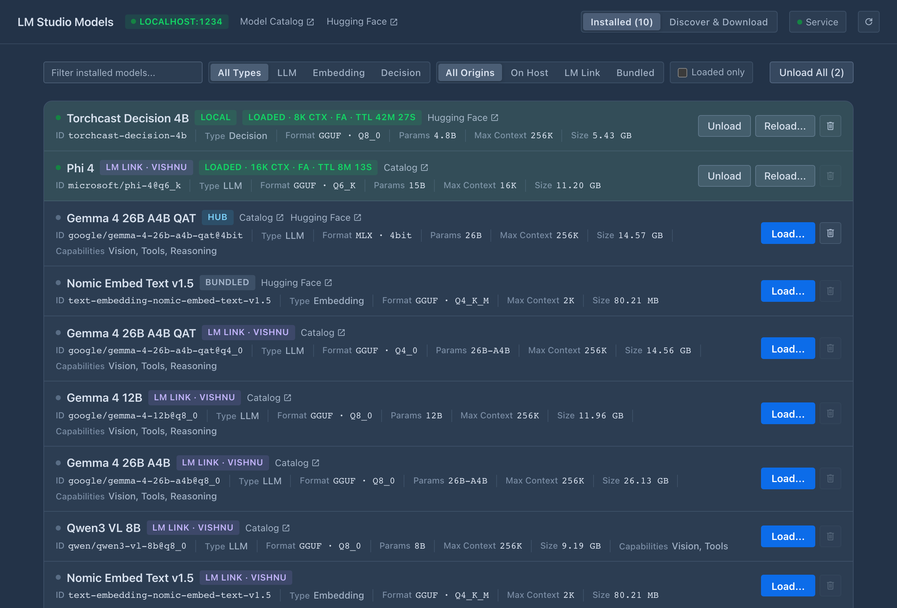

# LM Studio Model Manager (`lmstudio-webui`)



A lightweight, stateless control-plane WebUI and host proxy around [LM Studio's v1 REST API](https://lmstudio.ai/docs/developer/rest) focused on **model management** (everything that external chat apps and agent harnesses don't expose):

- **Model Inventory & Origin Resolution**: Browse LLMs, embedding models, and decision models (`GET /api/v1/models`), enriched with host index resolution (`local`, `hub` catalog virtual models, `bundled`, and remote `LM Link` peers), capabilities (`vision`, `tool_use`, `reasoning`), quantizations, and variants.
- **Load & Unload Tuning**: Load models (`POST /api/v1/models/load`) with custom `context_length`, `eval_batch_size`, `flash_attention`, `num_experts`, and `offload_kv_cache_to_gpu`, inspect active `loaded_instances` and `remaining_ttl_seconds`, and unload individual or all instances (`POST /api/v1/models/unload`).
- **Stateless Download Manager**: Pull models by LM Studio Catalog ID (`publisher/model`) or Hugging Face URL (`POST /api/v1/models/download`) with an automatic Hugging Face `.gguf` quantization picker, and monitor live download jobs directly from `~/.lmstudio/.internal/download-jobs-info.json` and `GET /api/v1/models/download/status/:job_id`.
- **Symmetrical Host Model Deletion**: Deterministically resolves `GET /api/v1/models` entries to their exact directories/files via `~/.lmstudio/.internal/model-index-cache.json` (handling both direct user models in `~/.lmstudio/models` and 2-part Hub virtual catalog models across `~/.lmstudio/hub/models` + `concreteModelDirAbsolutePath`), unloads active instances first, and deletes safely with strict path-containment checks.
- **Background Service Registration**: Built-in CLI and WebUI support to install/manage `lms-webui` as a persistent user service on **macOS (`launchd` LaunchAgent)** and **Linux (`systemd --user`)**.

## Quickstart

```bash
# Run server directly (defaults to port 8420, proxying http://localhost:1234)
uv run lms-webui serve --port 8420

# Register and start as a background service (macOS launchd or Linux systemd)
uv run lms-webui service install --port 8420

# Check service status
uv run lms-webui service status
```
